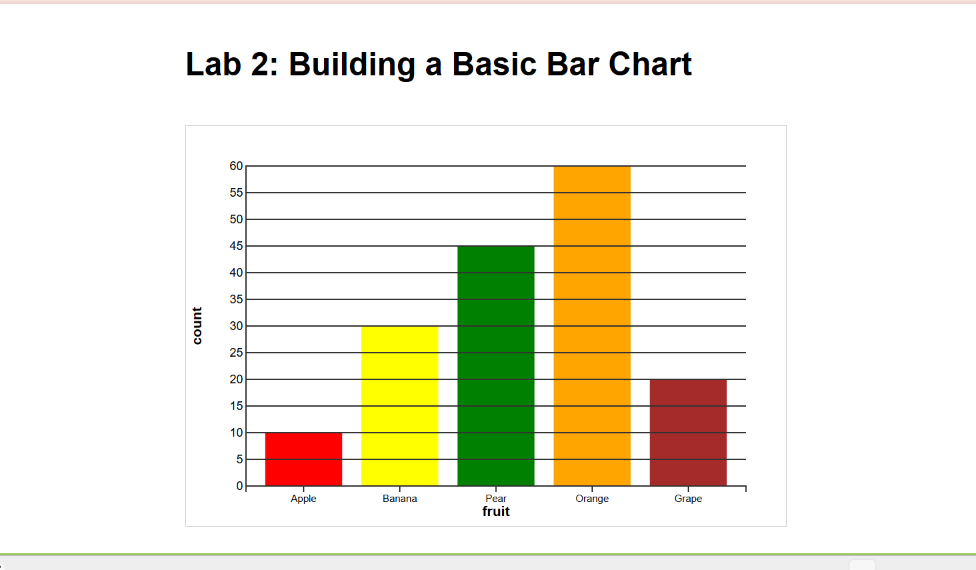

# Lab 2: Building a Basic Bar Chart

## Description
This project is a basic bar chart created with D3.js.
It visualizes fruit counts using rectangular bars and 
includes x - and y-axes, labels, scales, and grid lines.

## Features 
- Displays data using a bar chart
- Uses D3 scales to map data values to pixels
- Includes x- and y-axes
- Includes axis labels
- Uses horizontal grid lines 
- Uses customized colors

## Technologies 
- HTML
- CSS
- JavaScript
- D3.js
- SVG

## How to Run

1. Clone this repository.
2. Open the project folder in VS Code.
3. Start a local server.
4. Open the provided local URL in a browser.

## What I Learned
Through this project, I learned how to:

- Bind data to SVG elements using D3.js
- Use D3 scales to map data values to screen coordinates
- Create categorical and linear scales
- Create and position SVG rectangles
- Add x- and y-axes
- Use margins to create a chart area
- Add grid lines to improve readability

## The bar chart

## Author 
Meksud Buser

CMSC471 - Introduction to Information Visualization
